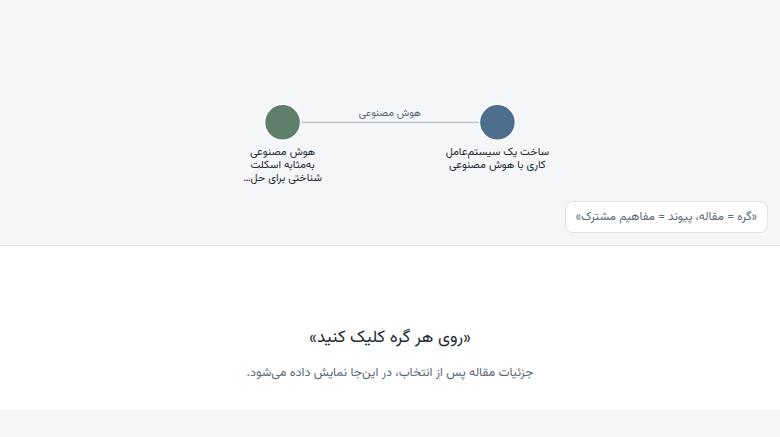

# research-graph

گراف دانشِ مقاله‌ها به‌زبان فارسی. یک مقاله بدهید (لینک، متن، یا PDF)؛ این ابزار عنوان فارسی، مفاهیم کلیدی، و سه بخش **مدعا / دلیل / نتیجه** را استخراج می‌کند، مقاله‌ها را روی مفاهیم مشترک به هم گره می‌زند، و یک گراف تعاملی در `graph.html` رسم می‌کند.

A Persian knowledge-graph tool for articles. Feed it a link, text, or PDF; it extracts a Persian title, key concepts, and a claim / reason / conclusion breakdown (max 5 paragraphs), links articles by shared concepts, and renders an interactive graph.



## چه می‌کند

- **تحلیل مقاله**: استخراج عنوان فارسی، ۳–۷ مفهوم مشترک، و بخش‌های مدعای/دلیل/نتیجه (مجموعاً حداکثر ۵ پاراگراف).
- **گراف دانش**: دو مقاله وقتی به هم وصل می‌شوند که دست‌کم یک مفهوم مشترک داشته باشند.
- **نمایش تعاملی**: یک صفحه‌ی `graph.html` با D3؛ روی هر گره کلیک کنید تا جزئیات مقاله را ببینید.
- **ورودی‌های متنوع**: لینک، متن جای‌گذاری‌شده، و فایل PDF (با `pdftotext`).

## ساختار

```
.
├── SKILL.md                 # دستورالعمل تحلیل مقاله برای عامل (Agent)
├── data/articles.json       # مخزن داده‌ی مقاله‌ها (منبع حقیقت)
├── examples/articles.json   # نمونه‌ی ورودی برای آزمایش
├── scripts/render_graph.py  # تبدیل داده به graph.html
└── graph.html               # خروجی (تولیدشده، نسخه‌بندی نمی‌شود)
```

## شروع سریع

**پیش‌نیاز**: Python 3 (بدون وابستگی خارجی)، و برای PDF: `poppler-utils`.

```bash
# ۱. اجرای رندر روی داده‌ی فعلی
python3 scripts/render_graph.py

# ۲. باز کردن گراف در مرورگر
# graph.html را باز کنید؛ روی هر گره کلیک کنید تا مقاله باز شود.
```

## افزودن مقاله

۱. شیء جدیدی به آرایه‌ی `articles` در `data/articles.json` اضافه کنید (یا فیلدهای یک مقاله‌ی موجود را ویرایش کنید):

```json
{
  "id": "شناسه-لاتفین-kebab",
  "title": "عنوان فارسی",
  "source": "لینک یا نام فایل",
  "concepts": ["مفهوم اول", "مفهوم دوم"],
  "claim": ["پاراگراف معا"],
  "reason": ["پاراگراف دلیل"],
  "conclusion": ["پاراگراف نتیجه"]
}
```

۲. رندر را دوباره اجرا کنید: `python3 scripts/render_graph.py`.

قوانین داده:

- `id` باید یکتا و به شکل `kebab-case` لاتین باشد.
- مجموع پاراگراف‌های `claim` + `reason` + `conclusion` حداکثر **۵** است.
- عناوین و متن‌ها فارسی‌اند؛ برای یکدستی گراف، مفاهیم مشترک را **دقیقاً** با همان رشته در مقاله‌های دیگر بنویسید.

## استفاده به‌عنوان Agent Skill

`SKILL.md` یک skill برای عامل‌های کدنویسی (مثل opencode) است. وقتی مقاله‌ای دادید، عامل خودش `data/articles.json` را به‌روز و رندر را اجرا می‌کند.

## گراف و مفاهیم

الگوریتم گراف ساده است: هر مقاله یک گره است؛ دو گره با یال وصل می‌شوند اگر مجموعه‌ی مفاهیمشان اشتراک داشته باشد. برچسب یال، مفاهیم مشترک را نشان می‌دهد. موتور چیدمان، `d3-force` است.

## لایسنس

MIT — جزئیات در [LICENSE](LICENSE).
